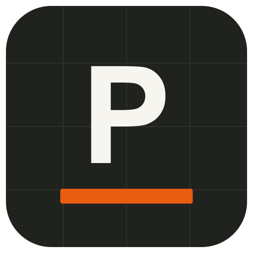

# Portravo for Claude

Portravo turns construction plan PDFs into AI takeoffs: quantities by trade, each with a confidence score and the extractor's notes. An estimator reviews every line, maps assemblies, and prices the estimate in Portravo, then downloads it as an Excel (XLSX) workbook. This plugin connects Claude to your Portravo account so you can start a takeoff from a plan, see what still needs review, check where all your estimates stand, draft scope questions, and download reviewed estimates. Before any takeoff runs, Claude checks the exact number of existing credits the selected trades need and asks you to approve that quote. The plugin never buys credits. Takeoff quantities are a starting point for review, not a bid.

## What it connects to

- **One remote MCP server:** `https://portravo.com/mcp` (Streamable HTTP). The plugin contacts nothing else and contains no scripts, hooks, or local servers.
- **Authentication:** OAuth 2.0 with PKCE and dynamic client registration. You sign in to Portravo and approve these permissions: `projects:read`, `projects:write`, `plans:write`, `extractions:write`, `estimates:read`, `offline_access`. The plugin stores no credentials; your Claude client holds the OAuth token.
- **Data sent to Portravo:** the tool arguments Claude sends on your behalf: project names, optional site addresses and pricing market codes, trade selections, project ids, idempotency keys, your approval to use credits with the approved credit ceiling, and plan PDFs you choose to attach (stored privately in your Portravo project).
- **Data returned to Claude:** your account name and email, trade availability, credit requirements and existing balance, upload limits, published prices, project names and statuses, takeoff progress and completion limitations, takeoff lines (trade, description, quantity, unit, confidence, review status, notes), plan file names and page counts, pricing markets, and short-lived workbook download links.
- Portravo processes plans with a third-party AI provider to produce takeoffs, as described in its privacy policy. Your conversation with Claude is covered by Anthropic's terms.

## Tools

| Tool | What it does | Access |
| --- | --- | --- |
| `get_profile` | Shows which Portravo account is connected. | Read-only |
| `preflight_takeoff` | Shows available trades, the exact existing-credit requirement, your balance, upload limits and published prices. Reserves, starts and buys nothing. | Read-only |
| `list_projects` | Lists your projects (draft, extracting, review, priced, final, failed), 50 per page. | Read-only |
| `get_takeoff` | Reads one project's takeoff lines, confidence, review status, plan files and market. | Read-only |
| `get_takeoff_status` | Reads a project's latest takeoff progress, completion limitations and review link. Never restarts a run or uses credits. | Read-only |
| `list_pricing_markets` | Lists supported regional pricing markets. | Read-only |
| `create_project` | Creates a draft estimate project for the selected trades. No credit used. | Write |
| `attach_plan_pdf` | Attaches the first plan PDF to a new project. No credit used. | Write |
| `run_takeoff` | Starts the AI takeoff for the approved trades, capped at the credit count you approved. Uses existing credits only, never billed overage. Failed provider runs are refunded. | Write |
| `export_reviewed_estimate` | Returns a short-lived XLSX download for a reviewed, priced or final estimate. | Read-only |

## Skills

| Skill | Triggers when you ask to |
| --- | --- |
| `start-plan-takeoff` | Start a takeoff or estimate from a plan PDF: check trades and credits, pick a market, create the project, attach the plan, approve the exact quote, run it, and follow it until it is done. |
| `review-takeoff` | Summarize a takeoff by trade and list the low-confidence, assumed, and unmapped lines to check first. |
| `project-status` | See all your projects grouped by status, or find one project, with next steps. |
| `export-reviewed-estimate` | Download the Excel estimate, or learn exactly what to finish in Portravo first. |
| `scope-gap-checklist` | Build a checklist of assumptions and omitted scope from the takeoff's notes, with draft RFI questions. |

## Setup

You need a Portravo account (sign up at https://portravo.com). Takeoffs use estimate credits from your balance; the plugin never buys credits.

- **Claude directory:** install the bundle once it is published, or connect the published Portravo MCP connector now. Sign in to Portravo when Claude asks.
- **Claude Code marketplace:** run `/plugin marketplace add johnarndt/soxoa-claude-plugins`, then `/plugin install portravo@soxoa-plugins`. Run `/mcp` and authenticate Portravo.
- **Connector only:** `claude mcp add --transport http portravo https://portravo.com/mcp` in Claude Code, or add `https://portravo.com/mcp` under Customize > Connectors in Claude apps.

To try it, download the sample plan at https://portravo.com/sample-plan.pdf and ask Claude to start a takeoff from it.

## Example prompts

- "Create a Portravo plumbing project for the Riverside workshop in Sacramento and attach this plan. Don't run it yet."
- "Run the takeoff on the Riverside workshop plan."
- "What still needs review on the Riverside workshop takeoff? Show low-confidence lines first."
- "Which of my Portravo estimates are priced and ready to download?"
- "Write RFIs from the assumptions in my Oak Lane duplex takeoff."

## Reviewer prompts

Use the synthetic reviewer credentials provided privately in the Claude developer portal. Complete normal Portravo verification if prompted. The isolated reviewer fixture uses the [one-page review PDF](https://portravo.com/mcp-review/one-page-plan.pdf) and a bounded standard-engine allowance. The customer sample above is for customer accounts.

These three prompts exercise reads on a connected account. They create no project, upload no file, and use no credits.

1. **Saved-project read:** "Which Portravo account am I connected as? List my projects by status, then summarize what still needs review on the most recent one in review." Uses `get_profile`, `list_projects` and `get_takeoff`.
2. **Priced export:** "Download the Excel estimate for my most recent priced or final Portravo project." Uses `list_projects` and `export_reviewed_estimate`. If review is incomplete, Claude explains what to finish in Portravo instead.
3. **Preflight only:** "Show preflight for my synthetic fixture project. Tell me what the reviewer scope allows. Do not start anything." Uses `preflight_takeoff` only after finding the owned fixture ID. The synthetic result identifies the standard-engine fixture. A customer trade estimate is a separate preflight without a project ID.

## Running a takeoff

- Claude calls `preflight_takeoff` for the project and shows you the selected trades, the exact `creditsRequired`, and your existing balance. It runs only after you say yes to that quote. The run is capped at the credit count you approved (the connection accepts 0 to 3), and a changed selection or cost is refused before anything starts.
- Takeoffs use existing plan allowance and purchased credits only. The plugin never buys credits or bills overage. If your balance is short, Claude points you to Portravo.
- Runs are asynchronous. Claude follows progress with `get_takeoff_status` and reports the takeoff as ready only after it shows done and `get_takeoff` confirms the result.
- **After a timeout or reconnect,** Claude checks `get_takeoff_status` first and never starts a second run while one exists. If no run started, it re-checks the quote. If the trades and credit count are unchanged, it retries with the same idempotency key, so you are not charged twice. If the quote changed, or your approval was given in a different conversation, Claude shows the new quote, asks again, and uses a new key.

## Limits and boundaries

- Takeoff quantities are extracted from plans and must be reviewed by an estimator. They are not bid-ready, and the plugin makes no accuracy guarantee.
- Pricing, assembly mapping, quantity edits, plan replacement, and re-runs of reviewed work happen in Portravo, not through Claude.
- The connection attaches a project's first plan only. Claude can send a plan of up to 10 MiB when the host provides a file link, or one of 32 KiB or smaller when Claude can read the exact file. Otherwise you upload it on the project page in Portravo, which accepts up to 50 MiB for the selected automatic trades. `preflight_takeoff` reports the current limits.
- Exports work only after every line is reviewed and the estimate is priced or final. Download links expire after about five minutes.
- Claude sees only the signed-in account's projects.

## Privacy, terms, support

- Privacy: https://portravo.com/privacy
- Terms: https://portravo.com/terms
- Support: https://portravo.com/support or hello@portravo.com
- Connection guide: https://portravo.com/developers/mcp

## License

MIT. See [LICENSE](LICENSE). Copyright (c) 2026 Soxoa LLC.
