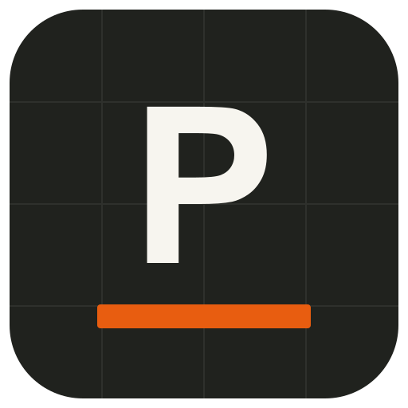

# Portravo for Claude

Portravo turns construction plan PDFs into AI takeoffs: quantities by trade, each with a confidence score and the extractor's notes. An estimator reviews every line, maps assemblies, and prices the estimate in Portravo, then downloads it as an Excel (XLSX) workbook. This plugin connects Claude to your Portravo account so you can start a takeoff from a plan, see what still needs review, check where all your estimates stand, draft scope questions, and download reviewed estimates. Running a takeoff uses one estimate credit from your existing Portravo balance, and Claude asks you first every time. Takeoff quantities are a starting point for review, not a bid.

## What it connects to

- **One remote MCP server:** `https://portravo.com/mcp` (Streamable HTTP). The plugin contacts nothing else and contains no scripts, hooks, or local servers.
- **Authentication:** OAuth 2.0 with PKCE and dynamic client registration. You sign in to Portravo and approve these permissions: `projects:read`, `projects:write`, `plans:write`, `extractions:write`, `estimates:read`, `offline_access`. The plugin stores no credentials; your Claude client holds the OAuth token.
- **Data sent to Portravo:** the tool arguments Claude sends on your behalf: project names, optional site addresses and pricing market codes, project ids, idempotency keys, your confirmation to use a credit, and plan PDFs you choose to attach (stored privately in your Portravo project).
- **Data returned to Claude:** your account name and email, project names and statuses, takeoff lines (trade, description, quantity, unit, confidence, review status, notes), plan file names and page counts, pricing markets, and short-lived workbook download links.
- Portravo processes plans with a third-party AI provider to produce takeoffs, as described in its privacy policy. Your conversation with Claude is covered by Anthropic's terms.

## Tools

| Tool | What it does | Access |
| --- | --- | --- |
| `get_profile` | Shows which Portravo account is connected. | Read-only |
| `list_projects` | Lists your projects (draft, extracting, review, priced, final, failed), 50 per page. | Read-only |
| `get_takeoff` | Reads one project's takeoff lines, confidence, review status, plan files and market. | Read-only |
| `list_pricing_markets` | Lists supported regional pricing markets. | Read-only |
| `create_project` | Creates a draft estimate project. No credit used. | Write |
| `attach_plan_pdf` | Attaches the first plan PDF to a new project. No credit used. | Write |
| `run_takeoff` | Runs the AI takeoff. Uses 1 estimate credit, only after you confirm. Failed runs are refunded. | Write |
| `export_reviewed_estimate` | Returns a short-lived XLSX download for a reviewed, priced or final estimate. | Read-only |

## Skills

| Skill | Triggers when you ask to |
| --- | --- |
| `start-plan-takeoff` | Start a takeoff or estimate from a plan PDF: pick a market, create the project, attach the plan, confirm the credit, run it. |
| `review-takeoff` | Summarize a takeoff by trade and list the low-confidence, assumed, and unmapped lines to check first. |
| `project-status` | See all your projects grouped by status, or find one project, with next steps. |
| `export-reviewed-estimate` | Download the Excel estimate, or learn exactly what to finish in Portravo first. |
| `scope-gap-checklist` | Build a checklist of assumptions and omitted scope from the takeoff's notes, with draft RFI questions. |

## Setup

You need a Portravo account (sign up at https://portravo.com). Takeoffs use estimate credits from your balance; the plugin never buys credits.

- **Claude directory:** install Portravo from the plugin directory, then sign in to Portravo when Claude asks.
- **Claude Code marketplace:** run `/plugin marketplace add johnarndt/soxoa-claude-plugins`, then `/plugin install portravo@soxoa-plugins`. Run `/mcp` and authenticate Portravo.
- **Connector only:** `claude mcp add --transport http portravo https://portravo.com/mcp` in Claude Code, or add `https://portravo.com/mcp` under Customize > Connectors in Claude apps.

To try it, download the sample plan at https://portravo.com/sample-plan.pdf and ask Claude to start a takeoff from it.

## Example prompts

- "Create a Portravo project for the Riverside workshop in Sacramento and attach this plan. Don't run it yet."
- "Run the takeoff on the Riverside workshop plan."
- "What still needs review on the Riverside workshop takeoff? Show low-confidence lines first."
- "Which of my Portravo estimates are priced and ready to download?"
- "Write RFIs from the assumptions in my Oak Lane duplex takeoff."

## Limits and boundaries

- Takeoff quantities are extracted from plans and must be reviewed by an estimator. They are not bid-ready, and the plugin makes no accuracy guarantee.
- Pricing, assembly mapping, quantity edits, plan replacement, and re-runs happen in Portravo, not through Claude.
- Plan PDFs must be 10 MiB or smaller. The connection attaches a project's first plan only. Claude can send a plan directly when the host provides a file link, or when Claude can read the exact file and it is 32 KiB or smaller; otherwise you upload it on the project page in Portravo.
- Each takeoff run uses one estimate credit and needs your explicit yes. Retries reuse an idempotency key so you are not charged twice.
- Exports work only after every line is reviewed and the estimate is priced or final. Download links expire after about five minutes.
- Claude sees only the signed-in account's projects.

## Privacy, terms, support

- Privacy: https://portravo.com/privacy
- Terms: https://portravo.com/terms
- Support: https://portravo.com/support or hello@portravo.com
- Connection guide: https://portravo.com/developers/mcp

## License

MIT. See [LICENSE](LICENSE). Copyright (c) 2026 Soxoa LLC.
